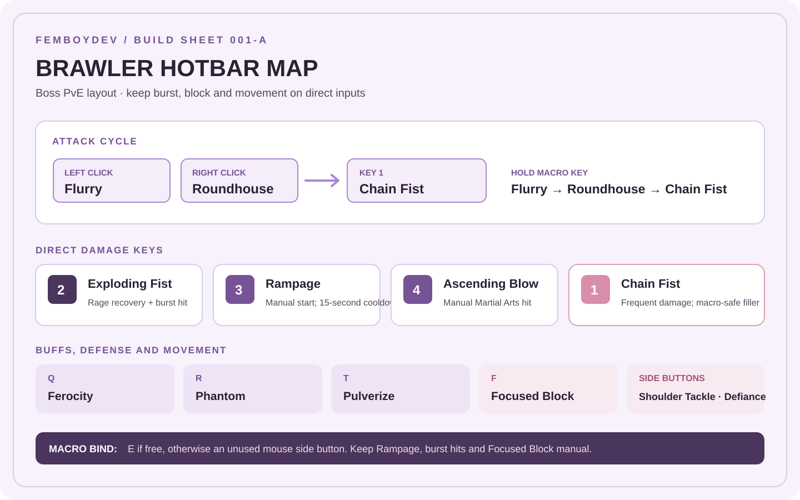
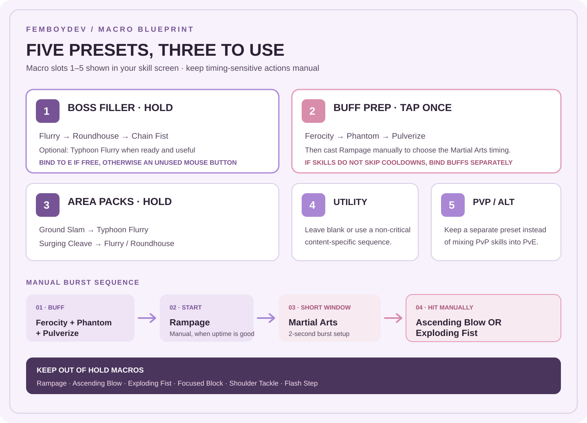
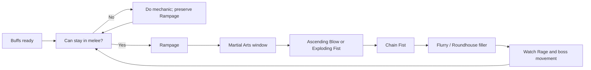

# Brawler PvE Build

**FemboyDev Field Notes 001-A** · Taiwan server · Reviewed 12 November 2026

> **Quick-copy page:** skill targets, specialization starting points, stigma picks, Arcana and macro layout. Open [Skills and Specializations](SKILLS.md), the [Arcana Guide](ARCANA.md), or the [Research Notes](RESEARCH_NOTES.md) for detail.

**Patch status:** Taiwan's 11 November update changed Rampage and several specializations. This page reflects those changes. Older guides may show obsolete cooldown and macro advice.

## Build Snapshot

| | PvE boss setup |
|---|---|
| **Role** | Close-range sustained damage |
| **Weapon** | Knuckles |
| **Difficulty** | Medium-high: Rage, frontal position and short burst windows need attention |
| **Core loop** | Flurry → Roundhouse → Chain Fist, with Exploding Fist for damage and Rage |
| **Burst window** | Rampage or Shoulder Tackle triggers Martial Arts; use Ascending Blow or Exploding Fist inside it |
| **Macro rule** | Automate fillers; cast Rampage, burst attacks, blocks and movement manually |

### Strengths and Trade-Offs

| Strengths | Trade-offs |
|---|---|
| Strong sustained melee damage and Rage recovery | Boss movement can interrupt the cycle |
| Martial Arts creates high-value burst windows | Frontal positioning is useful but sometimes unsafe |
| Focused Block can reward manual timing | Its current block window is only one second |

## Skill Setup

For the complete roster, canonical skill names, level system and patch-adjusted specialty notes, see [Skills and Specializations](SKILLS.md).

### Mastery Skill Targets

Use these as practical targets, not a rigid leveling law. Your displayed levels include bonuses from Arcana, gear and Daevanion.

| Order | Skill | Target | Priority reason |
|---:|---|---:|---|
| 1 |  **Ascending Blow** | 20 | Main burst attack; use during Martial Arts |
| 2 |  **Exploding Fist** | 20 | Damage plus Rage recovery; also benefits during Martial Arts |
| 3 |  **Rampage** | 20 | Main combat state and current Martial Arts trigger |
| 4 |  **Chain Fist** | 20 | Frequent high-priority damage skill |
| 5 |  **Flurry** | 16 → 20 | Basic attack and filler cycle |
| 6 |  **Roundhouse** | 16 → 20 | Basic attack and filler cycle |
| 7 |  **Ferocity** | 16+, then improve | Rage and damage-cycle support |
| 8 |  **Phantom**,  **Pulverize** | 16+, then improve | Commonly used offensive setup skills |

**Passives to prioritize:** Dominance, Rampage Amplification, Impact Hit and Frontal Breakthrough. Raise Massive Rage sooner if Rage sustain is the problem.

**Leveling checkpoints:** reach level 16 on the core skills first, then work toward level 20. The level-20 list above is a practical investment target, not a claim that every skill must be exactly level 20 before the others can improve.

<details>
<summary>Open the Taiwan sample for high-investment skill levels</summary>

The tracker sampled 1,080 Taiwan Brawlers using official character data collected 7 October 2026. These are average observed levels, not a prescribed skill order. The sample predates the 11 November patch.

| Skill | Average level |
|---|---:|
| Dominance | 24.9 |
| Ferocity | 24.8 |
| Rampage Amplification | 24.3 |
| Phantom | 23.0 |
| Pulverize | 22.8 |
| Impact Hit | 20.5 |
| Rampage | 20.1 |
| Ascending Blow | 19.4 |
| Roundhouse | 19.4 |
| Chain Fist | 19.3 |
| Massive Rage | 18.8 |
| Exploding Fist | 18.7 |
| Flurry | 18.1 |

</details>

### Stigma Skill Loadout

Taiwan's Chapter 1 update raised stigma skill levels to 25 and increased the number of equipped stigma slots to six. Start with the three highest-use offensive skills, then flex the remaining unlocked slots for the encounter.

| Slot role | Stigma skill | Use |
|---|---|---|
| Core |  **Ferocity** | High-use damage and Rage-cycle skill |
| Core |  **Phantom** | High-use offensive skill |
| Core |  **Pulverize** | High-use offensive skill |
| Flex damage |  **Surging Cleave** | Commonly equipped damage option |
| Flex damage |  **Discharge Energy** | Commonly equipped damage option |
| Flex survival |  **Focused Block** or  **Blood Flow Block** | Choose block utility or recovery for the encounter |

**Stigma leveling:** raise the three core damage choices first. Take the primary trio toward level 20, then improve the skills you actually keep equipped. Raise a flex defensive stigma when difficult content makes survival more valuable than another damage skill.

### Specialty Starting Point

These are player-tested starting selections. Recheck the Taiwan skill tooltip before using them because the November patch changed several effects.

| Skill | Starting choices | Current note |
|---|---|---|
| Flurry | 1 / 4 / 5 or 2 / 4 / 5 | Specialization 4 now grants skill critical rate, not Ascending Blow cooldown reduction |
| Roundhouse | 2 / 4 / 5 | Common tested baseline |
| Rampage | 1 / 3 / 5 | Specialization 5 now triggers a short Martial Arts window |
| Exploding Fist | 1 / 2 / 5 | Specialization 5 adds damage against incapacitation-immune targets |
| Ascending Blow | 2 / 5 | Keep ready for Martial Arts |
| Chain Fist | 3 / 4 / 5 | Check current attack-speed and Rampage-related effects |
| Typhoon Flurry | 1 / 4 / 5 or 2 / 4 / 5 | Choose damage, Rage or survival according to need |
| Gale Strike | 3 / 4 | Treat the movement choice as repositioning utility |
| Spinning Kick | 2 / 4 | Tested boss-damage choice |

## Arcana Setup

For all Arcana pools, the card sample and full roll advice, see the [Arcana Guide](ARCANA.md).

| Slot goal | Recommendation |
|---|---|
| Set | Work toward four Punishment pieces plus two flexible pieces |
| Main attack rolls | Ascending Blow, Exploding Fist, Rampage, Chain Fist, Flurry |
| Passive rolls | Rampage Amplification, Dominance, Impact Hit, Frontal Breakthrough |
| Rage problem | Consider Massive Rage |
| Survival problem | Keep stronger Protection or defensive rolls rather than forcing a damage set |

### Arcana Roll Map

| Arcana | Brawler pool and useful rolls |
|---|---|
| **Parchment** | Flurry, Rampage, Chain Fist, Spinning Kick, Exploding Fist, Ascending Blow |
| **Compass** | Roundhouse, Gale Strike, Typhoon Flurry, Ground Slam, Shoulder Tackle, Defiance |
| **Bell** | Rampage Amplification, Frontal Breakthrough, Impact Blow and other passives |
| **Mirror** | Dominance, Impact Hit, Massive Rage and other passives |
| **Chalice / Scales** | Broad skill pools; keep high-value core skill rolls |

**Reported offensive stat direction:** Time on Chalice, Death on Compass, Destruction on Bell, Wisdom on Mirror, and Destruction / Destiny on Scales. These are player targets, not official rules; compare skill levels and set bonuses too.

## Hotbar and Macro

The screenshot shows a macro panel with presets **1–5**, plus a hotbar using number keys and Q/E-style binds. The layout below uses those familiar keys as an example. Keep your own movement and interact keys if they differ.

### Suggested Hotbar

| Input | Put this here | Why |
|---|---|---|
| **Left mouse button** | Flurry | Basic attack and filler. |
| **Right mouse button** | Roundhouse | Pair with Flurry for the basic cycle. |
| **1** | Chain Fist | Frequent damage skill, easy to reach. |
| **2** | Exploding Fist | Manual Rage recovery and Martial Arts burst option. |
| **3** | Rampage | Keep manual so you choose when to start its damage window. |
| **4** | Ascending Blow | Keep manual for Martial Arts timing. |
| **Q** | Ferocity | Quick access to the main Rage-related buff. |
| **R** | Phantom | Buff setup. |
| **T** | Pulverize | Buff setup. |
| **F** | Focused Block | Must be manually timed. |
| **Mouse side button 1** | Shoulder Tackle | Approach or reposition; a hit can trigger Martial Arts. |
| **Mouse side button 2** | Defiance or Flash Step | Emergency control break or mobility. |
| **E** | Macro Preset 1: Boss Filler | Convenient hold-to-attack key; use another comfortable key if E is occupied. |

Keep **Blood Flow Block**, **Gale Strike** and **Ground Slam** on nearby secondary binds. If you use a controller or different key layout, preserve the same principle: filler on the held macro, burst and defense on direct inputs.



*The diagram follows the key style visible in your screenshot. Bind Macro Preset 1 to E only if E is free; otherwise use an unused mouse side button or another comfortable key.*

### Macro Preset Plan

The macro panel in your screenshot has five numbered presets. Use them like this; unused presets can stay empty.

| Macro preset | Name it | Bind / use | Contents |
|---:|---|---|---|
| **1** | Boss Filler | Hold on E or a mouse side button | Flurry → Roundhouse → Chain Fist → optional Typhoon Flurry |
| **2** | Buff Prep | Tap once before the burst | Ferocity → Phantom → Pulverize. Cast Rampage manually afterward. |
| **3** | AoE / Packs | Hold only while enemies are grouped | Ground Slam → Typhoon Flurry → Surging Cleave → Flurry / Roundhouse |
| **4** | Utility | Optional; normally leave unused | Do not automate Focused Block or movement. Keep those on direct keys. |
| **5** | Alternate Build | Optional PvP or survival preset | Swap to a separate manual setup rather than mixing it into the boss macro. |



### Macro Preset 1: Boss Filler

Use the in-game priority or repeating macro system. Do not set ultra-short timings copied from old launch macros.

```text
Flurry
Roundhouse
Chain Fist
Flurry
Roundhouse
Typhoon Flurry, when ready and appropriate
```

Keep Rampage, Ferocity, Phantom, Pulverize, Exploding Fist, Ascending Blow, Focused Block and movement skills out of this unattended loop. The goal is a filler cycle that keeps attacking without spending your burst or defensive actions at the wrong time.

### Macro Preset 2: Buff Prep

Optional one-shot sequence:

```text
Ferocity
Phantom
Pulverize
```

Tap this before your burst. Cast **Rampage** manually after the buffs are active so you control when Martial Arts begins. If the macro system does not skip skills that are unavailable, bind these buffs separately instead of chaining them.

### Manual Opener and Burst

```text
Before engage: build Rage; confirm key skills are ready
Apply: Ferocity → Phantom → Pulverize
Start: Rampage
During Martial Arts: Ascending Blow or Exploding Fist
Continue: Chain Fist → Flurry / Roundhouse filler
```

If Shoulder Tackle is needed to close distance, a hit can trigger a separate short Martial Arts window. Follow it with the best attack that can land before the effect expires.

### Macro Preset 3: Area Filler

```text
Ground Slam
Typhoon Flurry
Surging Cleave
Flurry
Roundhouse
```

Use against grouped enemies. Remove movement or area skills from the sequence if they frequently fire after targets have moved.

### Keep Manual

- **Focused Block:** its current block duration is one second.
- **Rampage:** cooldown is 15 seconds, and the fifth specialization creates a short burst window.
- **Ascending Blow and Exploding Fist:** time them with Martial Arts.
- **Shoulder Tackle, Gale Strike and Flash Step:** use for real movement needs, not automatic cooldown cycling.

> The August 2026 minimum skill-cancellation update makes very fast legacy macros unreliable. Use in-game Combat Support, test the sequence on a target dummy, and adjust only after observing which skills actually cast.

> **Important:** Do not put Rampage in the hold-to-attack loop. Do not put Focused Block, Shoulder Tackle or Flash Step in an unattended repeat macro. The macro should fill downtime, not decide when your burst or defense happens.

## Combat Loop



## Patch Changes That Affect This Build

| Date | Change |
|---|---|
| 8 July 2026 | Blood Flow Block received a life-absorption effect. |
| 22 July 2026 | A Gale Strike specialization became a move-to-front option. |
| 26 August 2026 | Minimum skill-cancellation timing affected high-speed macros. |
| 14 October 2026 | Rampage gained 20% PvE damage resistance while active. |
| 11 November 2026 | Rampage cooldown became 15 seconds; its fifth specialization now grants Martial Arts. Shoulder Tackle can also trigger Martial Arts. Focused Block was shortened to one second and given a 10-second cooldown. |

## Full Research and Sources

For the complete reference set, see [Skills and Specializations](SKILLS.md), the [Arcana Guide](ARCANA.md), and the [Research Notes](RESEARCH_NOTES.md). Return to the [repository home](README.md).

- [Official Taiwan skill guide](https://tw.ncsoft.com/aion2/guidebook/view?title=%E6%8B%B3%E6%98%9F%E6%8A%80%E8%83%BD)
- [Official Taiwan update, 11 November 2026](https://tw.ncsoft.com/aion2/board/update/view?articleId=6af393e028c745263507304c)
- [Chapter 1 update coverage: stigma skills and skill growth changes](https://www.4gamers.com.tw/news/detail/80410/nc-aion2-chapter1-land-of-sand-and-frost-update-launchd)
- [Official Taiwan update, 26 August 2026](https://tw.ncsoft.com/aion2/board/update/view?articleId=6a8dfb48fa34c1011d627473)
- [Taiwan Brawler build statistics](https://gamewith.ai/aion2/en/build-stats/tw/fighter), gathered 7 October 2026
- [English Brawler skill database](https://aion2.dvg.cn/en/skill_list.php?category=%E6%8B%B3%E6%98%9F)
- [Player testing: skills and specializations](https://forum.gamer.com.tw/C.php?bsn=82913&snA=5771)
- [Player testing: macro and build setup](https://forum.gamer.com.tw/C.php?bsn=82913&snA=5921)

---

*FemboyDev Field Notes 001-A · Independent player reference · Not affiliated with NCSOFT.*
