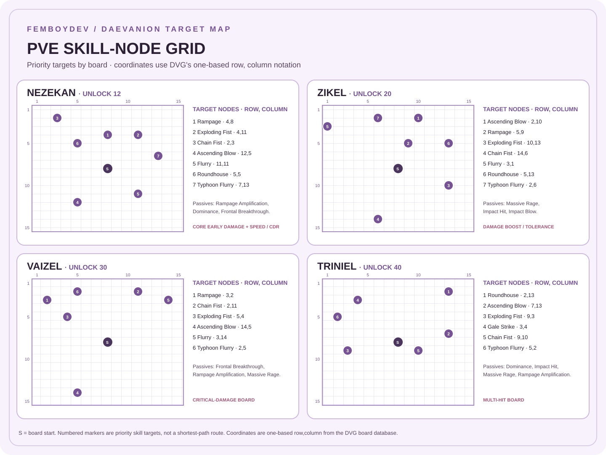

# Brawler Daevanion Selection Grid

**FemboyDev Field Notes 001-I** · Taiwan server · PvE boss damage · Board data checked 12 November 2026

This is a **target-node grid** for a PvE Brawler, not a fixed path that assumes every character owns the same nodes. Coordinates and node names come from the [DVG Taiwan Brawler board database](https://aion2.dvg.cn/en/daevanion_board_list.php?category=%E6%8B%B3%E6%98%9F). Preferred skill names follow [Skills and Specializations](SKILLS.md).

## Contents

- [How to read the grid](#how-to-read-the-grid)
- [Visual target map](#visual-target-map)
- [Target-node priority](#target-node-priority)
- [Board-by-board plan](#board-by-board-plan)
- [Node cost and routing](#node-cost-and-routing)
- [Sources](#sources)

## How to Read the Grid

- **S** marks the board start node, normally the center of the 15 × 15 grid.
- Numbered markers indicate useful Brawler skill nodes. A marker number is a target priority within that board, **not** a guaranteed shortest-path order.
- Coordinates use the DVG board's one-based **row, column** notation. For example, `4,8` means row 4, column 8.
- You can only purchase nodes connected to your owned area. Stat and connector nodes on the way also cost points.
- Calculate your route from the nodes you already own. Your budget and previously purchased paths will change the cheapest order.

## Visual Target Map

The graphic marks target skill nodes only. It does not draw connector paths, so use the live board viewer to plan the route from your current owned nodes.

## Target-Node Priority

### Nezekan, level 12

| Priority | Node | Coordinate | Node type |
|---:|---|---:|---|
| 1 | Rampage | 4,8 | Active skill, cost 3 |
| 2 | Exploding Fist | 4,11 | Active skill, cost 3 |
| 3 | Chain Fist | 2,3 | Active skill, cost 3 |
| 4 | Ascending Blow | 12,5 | Active skill, cost 3 |
| 5 | Flurry | 11,11 | Active skill, cost 3 |
| 6 | Roundhouse | 5,5 | Active skill, cost 3 |
| 7 | Typhoon Flurry | 7,13 | Active skill, cost 3 |
| Flex | Rampage Amplification, Dominance, Frontal Breakthrough | 6,10; 3,15 or 10,6; 1,10 | Passive skill, cost 2 |

### Zikel, level 20

| Priority | Node | Coordinate | Node type |
|---:|---|---:|---|
| 1 | Ascending Blow | 2,10 | Active skill, cost 3 |
| 2 | Rampage | 5,9 | Active skill, cost 3 |
| 3 | Exploding Fist | 10,13 | Active skill, cost 3 |
| 4 | Chain Fist | 14,6 | Active skill, cost 3 |
| 5 | Flurry | 3,1 | Active skill, cost 3 |
| 6 | Roundhouse | 5,13 | Active skill, cost 3 |
| 7 | Typhoon Flurry | 2,6 | Active skill, cost 3 |
| Flex | Massive Rage, Impact Hit | 6,7; 7,11 | Passive skill, cost 2 |

### Vaizel, level 30

| Priority | Node | Coordinate | Node type |
|---:|---|---:|---|
| 1 | Rampage | 3,2 | Active skill, cost 3 |
| 2 | Chain Fist | 2,11 | Active skill, cost 3 |
| 3 | Exploding Fist | 5,4 | Active skill, cost 3 |
| 4 | Ascending Blow | 14,5 | Active skill, cost 3 |
| 5 | Flurry | 3,14 | Active skill, cost 3 |
| 6 | Typhoon Flurry | 2,5 | Active skill, cost 3 |
| Flex | Frontal Breakthrough, Rampage Amplification, Massive Rage | 3,8; 5,13; 6,9 | Passive skill, cost 2 |

### Triniel, level 40

| Priority | Node | Coordinate | Node type |
|---:|---|---:|---|
| 1 | Ascending Blow | 7,13 | Active skill, cost 3 |
| 2 | Exploding Fist | 9,3 | Active skill, cost 3 |
| 3 | Chain Fist | 9,10 | Active skill, cost 3 |
| 4 | Rampage | 14,3 | Active skill, cost 3 |
| 5 | Roundhouse | 2,13 | Active skill, cost 3 |
| 6 | Typhoon Flurry | 5,2 | Active skill, cost 3 |
| Flex | Dominance, Impact Hit, Massive Rage, Rampage Amplification | 4,14; 3,10; 13,6; 9,6 | Passive skill, cost 2 |

The priority numbers follow the build's general skill investment order. If one of those skills already has enough levels from gear or Arcana, skip it and take the next useful reachable node.

## Board-by-Board Plan

| Board | Unlock | Board specialty | Brawler plan |
|---|---:|---|---|
| **Nezekan** | 12 | Combat Speed and Cooldown Reduction | Start with the nearest core active skill nodes and useful passives. |
| **Zikel** | 20 | Damage Boost and Damage Tolerance | Continue core skill levels; add Massive Rage or Impact Hit if useful. |
| **Vaizel** | 30 | Critical Damage Boost and Critical Damage Tolerance | Continue active/passive levels and take the offensive specialty nodes that fit PvE. |
| **Triniel** | 40 | Multi-hit Chance and Multi-hit Resist | Finish core skill nodes; compare its Multi-hit specialty nodes with your current stats. |
| **Ariel** | 45 | PvE stats | Prioritize PvE Accuracy if needed, then PvE Attack, Boss Attack and damage boost. |
| **Azphel** | 45 | PvP stats | Keep for a separate PvP setup: PvP Attack, Status Effect Chance and Status Effect Resist. |
| **Marchutan** | 45 | Season 2 stats | Optional tuning; includes Weapon Damage Boost and Endurance-related nodes. |
| **Yustiel** | 45 | Season 3 stats | Optional tuning; includes defensive and utility stats. |

### Practical order for a new PvE Brawler

1. **Level 12:** use Nezekan for reachable Rampage, Exploding Fist and Chain Fist level nodes. Pick up the stat and passive nodes on a cost-efficient route.
2. **Level 20:** use Zikel to add Ascending Blow, Exploding Fist, Rampage and filler skill levels.
3. **Level 30:** use Vaizel to continue core skill levels and take its offensive specialty nodes where practical.
4. **Level 40:** use Triniel to fill missing core skill levels and decide whether Multi-hit nodes improve your current build.
5. **Level 45:** use Ariel for PvE. Keep Azphel separate for PvP. Season boards are optional stat tuning, not mandatory PvE skill paths.

This is a priority plan, not a claim that one route has the lowest possible point cost. If your core skills already reach their level targets through Arcana or gear, shift points to the best accessible stat or passive node.

## Node Cost and Routing

| Node category | Typical cost |
|---|---:|
| Common stat node | 1 point |
| Passive skill-level node | 2 points |
| Active skill-level node | 3 points |
| Unique specialty node | 4 points |

The route costs more than the target node when connector nodes are unowned. Use the DVG map to trace a connected path from your current board state; do not spend toward a distant marker until you have compared its full route cost with nearby nodes.

### Board maps

- [Nezekan](https://aion2.dvg.cn/en/daevanion_board_info.php?id=91) · [Zikel](https://aion2.dvg.cn/en/daevanion_board_info.php?id=92) · [Vaizel](https://aion2.dvg.cn/en/daevanion_board_info.php?id=93) · [Triniel](https://aion2.dvg.cn/en/daevanion_board_info.php?id=94)
- [Ariel](https://aion2.dvg.cn/en/daevanion_board_info.php?id=95) · [Azphel](https://aion2.dvg.cn/en/daevanion_board_info.php?id=96) · [Marchutan](https://aion2.dvg.cn/en/daevanion_board_info.php?id=97) · [Yustiel](https://aion2.dvg.cn/en/daevanion_board_info.php?id=98)
- [General Daevanion board guide](https://aion2.wiki.fextralife.com/Daevanion+Boards)

## Sources and Caveats

- Board nodes and coordinates: [DVG Taiwan Brawler board database](https://aion2.dvg.cn/en/daevanion_board_list.php?category=%E6%8B%B3%E6%98%9F), updated 29 October 2026.
- Skill priorities: [Brawler Build Sheet](BRAWLER_BUILD.md) and [Skills and Specializations](SKILLS.md).
- The DVG grid lists nodes; the marked order here is a build priority, not an optimized path for every owned-node state.
- Confirm node positions and costs in the Taiwan client before spending scarce points.

---

*FemboyDev Field Notes 001-I · Independent player reference · Not affiliated with NCSOFT.*
