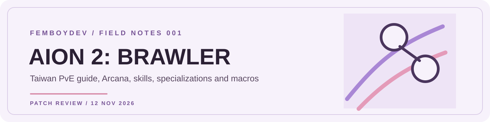
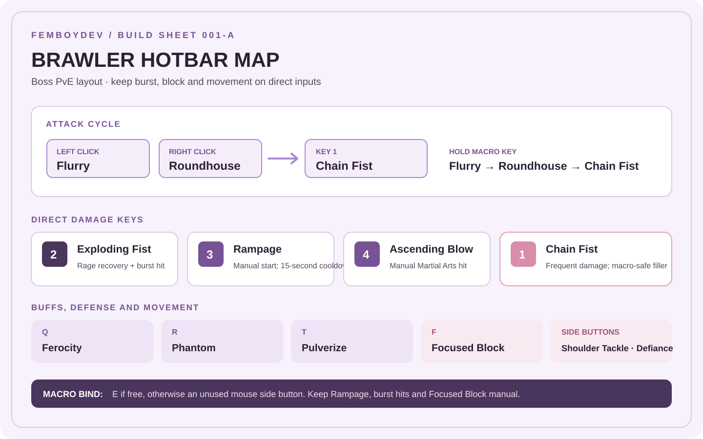
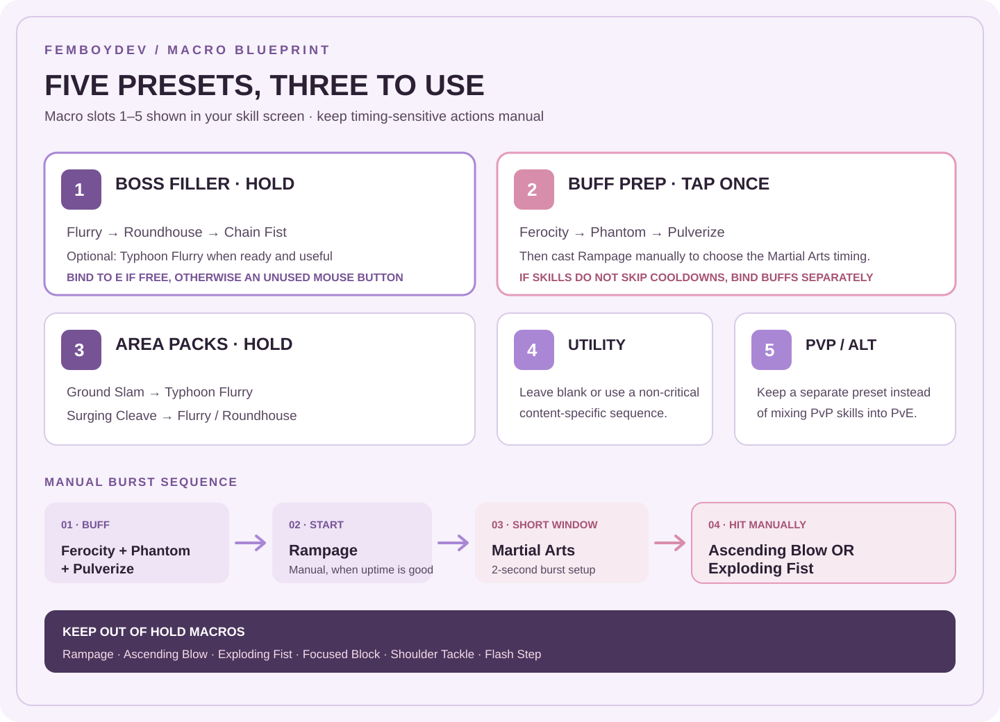

# FemboyDev · AION 2 Brawler

An independent Taiwan-server Brawler guide, organized for quick use during gearing and combat. English skill labels are used throughout. This is a player reference, not an official NCSOFT guide.

**Reviewed for Taiwan through 12 November 2026.** The most recent Brawler changes in this guide are from 11 November.

| Start here | What you get |
|---|---|
| **[Brawler Build Sheet](BRAWLER_BUILD.md)** | Quick PvE setup, hotbar diagram and macro presets. |
| **[Content Builds](CONTENT_BUILDS.md)** | Boss, AoE, solo-survival and PvP profiles with swap rules. |
| **[Skills and Specializations](SKILLS.md)** | Preferred English names, leveling order, stigma loadout and current specialization notes. |
| **[Arcana Guide](ARCANA.md)** | Set plan, skill pools, roll priorities and stat targets. |
| **[Gear and Daevanion](GEAR_DAEVANION.md)** | Stat priorities, gear sample, board unlocks and skill-node route guidance. |
| **[English Resources for Taiwan](ENGLISH_RESOURCES.md)** | English-friendly databases, Taiwan patch sources and translated community resources. |
| **[Community Guide Summary](PLAYER_GUIDE_SUMMARY.md)** | English notes on an older Taiwan macro/build guide and the later patch changes. |
| **[Research Notes](RESEARCH_NOTES.md)** | Class mechanics, combat priorities, patch timeline, statistics and source methodology. |
| **[Skill database](https://aion2.dvg.cn/en/skill_list.php?category=%E6%8B%B3%E6%98%9F)** | English skill labels and icons. |

## Quick Setup

| Part | PvE starting point |
|---|---|
| **Filler loop** | Flurry → Roundhouse → Chain Fist. Add Typhoon Flurry only if it behaves well in your macro. |
| **Burst** | Ferocity → Phantom → Pulverize → manually cast Rampage → Ascending Blow or Exploding Fist during Martial Arts. |
| **Skill levels** | Core skills toward 16 first; then prioritize Ascending Blow, Exploding Fist, Rampage and Chain Fist toward 20. |
| **Arcana** | Four Punishment pieces plus two flexible pieces is a target, not a rule. Keep strong skill rolls and survival options. |
| **Keep manual** | Rampage, Ascending Blow, Exploding Fist, Focused Block and movement skills. |

## Hotbar and Macro Visuals

The build sheet includes the full key-by-key recommendation and macro preset notes. These diagrams are also available as standalone files:

- [Hotbar map](assets/brawler-hotbar-map.svg)
- [Macro preset map](assets/brawler-macro-map.svg)

Preview the hotbar and macro diagrams

## Current-Patch Reminders

- Rampage cooldown is **15 seconds**.
- Rampage's fifth specialization now triggers a short Martial Arts window; the old all-skill cooldown reduction is gone.
- Flurry-chain specialization 4 no longer reduces Ascending Blow's cooldown.
- Focused Block lasts **one second**. Use it manually.
- The August minimum skill-cancellation change makes old ultra-fast macros unreliable.

## Source and Version Notes

Official Taiwan patch notes take priority for current effects. The detailed guide separates those notes from player-tested builds and October statistics, which predate the 11 November changes.

- [Taiwan 11 November update](https://tw.ncsoft.com/aion2/board/update/view?articleId=6af393e028c745263507304c) · Current Rampage, Martial Arts and Focused Block changes.
- [Taiwan Brawler skill database](https://aion2.dvg.cn/en/skill_list.php?category=%E6%8B%B3%E6%98%9F) · English skill labels and icons.

**FemboyDev Field Notes 001** · Warm-paper, plum and orchid visual identity · Not affiliated with NCSOFT.
