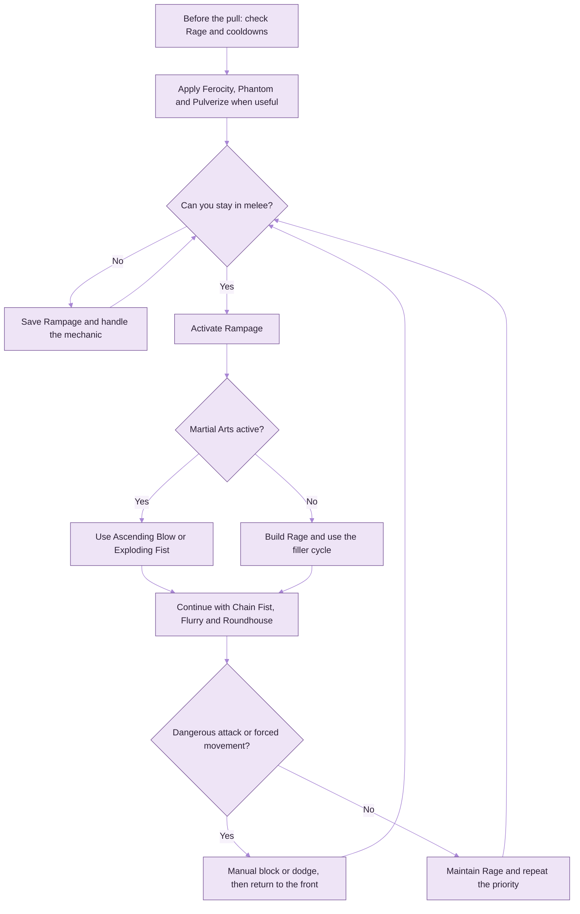
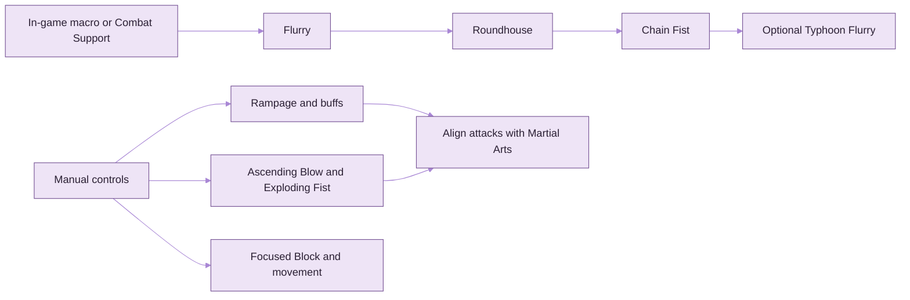

# AION 2 Brawler Guide

**FemboyDev Field Notes 001** · Taiwan server · PvE-first · Reviewed 12 November 2026

An independent, English-language player guide to the Brawler: skill priorities, specialization choices, Arcana, rotations and practical in-game macro templates. It is not an official NCSOFT guide.

Skill names use English-language AION 2 database translations. Some databases use different English names for the same skill; common aliases are listed where useful. The Taiwan client may display localized names.

> **Patch warning:** Taiwan received a major Brawler update on 11 November 2026. Older player builds are still useful for understanding the class, but several specialization effects and macro assumptions changed. The current-patch corrections are called out below.

## Contents

- [Class Summary](#class-summary)
- [Core Mechanics](#core-mechanics)
- [Skill Reference](#skill-reference)
- [Skill Icon Gallery](#skill-icon-gallery)
- [Skill Progression](#skill-progression)
- [Specializations](#specializations)
- [Arcana](#arcana)
- [PvE Rotation](#pve-rotation)
- [Rotation Infographic](#rotation-infographic)
- [Macros and Combat Support](#macros-and-combat-support)
- [Macro Infographic](#macro-infographic)
- [PvP Notes](#pvp-notes)
- [Patch History and Outdated Advice](#patch-history-and-outdated-advice)
- [Sources and Research Notes](#sources-and-research-notes)

## Quick Start

| If you only need… | Start here |
|---|---|
| A safe boss setup | Use the [single-target priority](#single-target-boss-priority). Keep Flurry, Roundhouse and Chain Fist in the filler macro; use burst and defense manually. |
| Skill investments | Raise core skills toward level 16, then work toward level 20 on Ascending Blow, Exploding Fist, Rampage and Chain Fist. See [Skill Progression](#skill-progression). |
| Arcana direction | Build toward four Punishment pieces with two flexible pieces, but compare skill rolls before forcing the set. See [Arcana](#arcana). |
| Current patch changes | Read [Current-Patch Changes](#current-patch-changes). The 11 November update changed Rampage and several specializations. |
| Macro setup | Use [Macro A](#macro-a-basic-single-target-cycle) for fillers; leave Rampage, burst attacks, blocks and movement manual. |

> **FemboyDev build note:** cute colors, serious uptime. This is a player-maintained reference, not an official class endorsement or a claim of a universal best build.

---

## Class Summary

**Brawler** is a close-range damage class built around **Rage**, **Rampage**, frontal attacks and short burst windows.

| Topic | Summary |
|---|---|
| Role | Melee damage |
| Main resource | Rage |
| Core state | Rampage |
| Main damage pattern | Repeated melee attacks, frontal positioning and short burst windows |
| Main risk | Boss mechanics can force movement or downtime, disrupting Rage and attack uptime |
| Recommended approach | Keep the basic cycle moving, time burst skills with buffs, and use defense manually |

### Strengths

- Strong sustained melee damage while the target remains in range.
- Rage-generating attacks support the Rampage cycle.
- Focused Block can reward good timing with counterattacks and cooldown benefits.
- The November 2026 patch added short, high-value Martial Arts windows to the damage plan.

### Weaknesses

- Many attacks favor frontal damage, which can conflict with boss mechanics.
- Close-range play makes movement and positioning especially important.
- Rampage depends on Rage and attack uptime. Using it immediately before a forced movement phase can waste its value.
- Brawler is not a class where an unattended macro should handle the entire fight.

**Positioning rule:** attack from the front when safe. Move out of dangerous attacks even if it costs damage.

---

## Core Mechanics

### Rage

Brawler builds Rage through attacks and skills. **Exploding Fist** is especially important because it contributes both damage and Rage recovery.

Avoid two extremes:

- Do not use every Rage-generating skill while already near the Rage cap.
- Do not wait until Rampage is about to end before thinking about Rage recovery.

Rage needs vary with skill levels, Arcana, equipment, cooldowns and time away from the boss. Observe your own Rage drain and recovery rather than relying on an old fixed Rage target.

### Rampage

**Rampage** is the center of Brawler's damage cycle. Use it when you expect to remain in melee and attack, rather than activating it automatically whenever it is ready.

The Taiwan patch on **11 November 2026** changed Rampage's cooldown from 10 seconds to **15 seconds**. Its fifth specialization was also changed: instead of reducing all skill cooldowns during Rampage, it now grants a brief **Martial Arts** effect when Rampage is cast.

### Frontal Damage

Brawler's kit favors attacks from the front. Hold a frontal position when the encounter allows it, but do not take a boss attack just to preserve frontal uptime.

### Martial Arts

The 11 November patch made short Martial Arts windows a key part of Brawler's burst:

- Rampage's fifth specialization can grant Martial Arts when Rampage is cast.
- Hitting with **Shoulder Tackle** grants a brief Martial Arts effect.
- During Martial Arts, **Ascending Blow** and **Exploding Fist** receive a large PvE damage increase. The Taiwan patch notes state a 150% PvE damage increase and a 50% PvP damage increase during the effect.

The window is short. Have a high-value attack ready before triggering it. Do not assume you can fit both Ascending Blow and Exploding Fist into every window; use the one that is ready and most likely to land before the effect expires.

---

## Skill Reference

English skill translations vary slightly between databases. For example, the basic attack **Flurry** is also listed as **Combo Strike**, and **Roundhouse** is also listed as **Flying Kick**. The table focuses on each skill's practical role rather than reproducing every tooltip line.

### Skill Icon Gallery

The icons below are linked from the public [AION 2 Brawler skill database](https://aion2.dvg.cn/en/skill_list.php?category=%E6%8B%B3%E6%98%9F). They are externally hosted game-reference images, not files stored in this guide. The names beneath each icon use the English database labels.

#### Core Active Skills

| Icon | Skill | Icon | Skill | Icon | Skill |
|---|---|---|---|---|---|
|  | Flurry |  | Roundhouse |  | Rampage |
|  | Ascending Blow |  | Exploding Fist |  | Chain Fist |
|  | Gale Strike |  | Ground Slam |  | Spinning Kick |
|  | Shoulder Tackle |  | Typhoon Flurry |  | Ferocity |
|  | Surging Cleave |  | Focused Block |  | Phantom |
|  | Pulverize |  | Blood Flow Block |  | Defiance |

#### Additional Active and Utility Skills

| Icon | Skill | Icon | Skill | Icon | Skill |
|---|---|---|---|---|---|
|  | Quake |  | Unstoppable |  | Full Force |
|  | Assault Blow |  | Discharge Energy |  | Time Bomb |
|  | Flash Step |  |  |  |  |

#### Passive Skill Icons

| Icon | Passive | Icon | Passive |
|---|---|---|---|
|  | Dominance |  | Rampage Amplification |
|  | Impact Hit |  | Frontal Breakthrough |
|  | Massive Rage |  | Hold the Line |
|  | Mental Conversion |  | Impact Blow |
|  | Revitalization Contract |  | Lightweight |

Other Brawler skill icons are available from the linked database. The icon source is maintained externally, so a source-site change could break the images.

### Core Active Skills

| Skill | Common alternate name | Practical role |
|---|---|---|
| **Flurry** | Combo Strike | Basic attack and part of the repeating attack cycle. |
| **Roundhouse** | Flying Kick | Basic-cycle attack, commonly paired with Flurry. |
| **Ferocity** | Fury | Rage-related combat buff. |
| **Rampage** | — | Main combat state; its current fifth specialization can trigger Martial Arts. |
| **Exploding Fist** | Explosive Fist | Damage and Rage recovery; a major skill to time with Martial Arts. |
| **Ascending Blow** | Ascending Strike | High-priority damage skill; use during Martial Arts when possible. |
| **Chain Fist** | — | Important repeated damage skill. |
| **Phantom** | — | Offensive buff or combat skill, commonly used during the opening setup. |
| **Pulverize** | Shatter | Offensive buff or combat skill, commonly used during the opening setup. |
| **Air Rending Slash** | Surging Cleave | Damage and approach option. |
| **Gale Strike** | Whirlwind | Approach or repositioning skill; one specialization was changed to move Brawler in front of the target. |
| **Shoulder Tackle** | Iron Mountain Charge | Positioning skill that can trigger Martial Arts when it hits. |
| **Typhoon Flurry** | Typhoon Barrage | Damage and follow-up skill; specialization can trade damage for sustain. |
| **Focused Block** | — | Manually timed block. Use it against readable attacks. |
| **Blood Flow Block** | — | Recovery or sustain option. |
| **Ground Slam** | Smite Ground | Situational damage, control or utility. |
| **Spinning Kick** | Sweeping Kick | Follow-up or conditional attack; useful when its trigger is available. |
| **Flash Step** | — | Mobility option. |
| **Defiance** | — | Crowd-control escape skill. |

### Other Brawler Skills

These skills appear in the English-language Brawler database. Their usefulness depends on the build, content and current tooltip:

- **Quake**
- **Unstoppable**
- **Full Force**
- **Assault Blow**
- **Discharge Energy**
- **Time Bomb**

### Brawler Passives

| Passive | Build relevance |
|---|---|
| **Dominance** | Also translated as Intimidation. A high-priority offensive passive in the Taiwan build sample. |
| **Rampage Amplification** | Also translated as Rampage Boost. A high-priority Rampage-related passive. |
| **Impact Hit** | Commonly prioritized damage passive. |
| **Frontal Breakthrough** | Also translated as Shatter Frontline. Fits Brawler's frontal damage pattern. |
| **Massive Rage** | Also translated as Colossal Rage. Relevant when Rage capacity or sustain is a concern. |
| **Hold the Line** | Defensive or sustain-oriented passive. |
| **Mental Conversion** | Also translated as Mind Shift. Passive option in the Arcana skill pool. |
| **Impact Blow** | Passive option in the Arcana skill pool. |
| **Revitalization Contract** | Passive option in the Arcana skill pool. |
| **Lightweight** | Passive option in the Arcana skill pool. |

---

## Skill Progression

Skill levels come from several systems, including normal skill investment, Daevanion, equipment and Arcana. A high-level character's displayed skill level may include bonuses from several of these sources.

### Recommended Investment Order

| Priority | Skills | Reason |
|---|---|---|
| **Top** | **Ferocity, Rampage, Phantom, Pulverize** | Core buffs and Rage-cycle support. |
| **Top** | **Ascending Blow, Exploding Fist** | Major damage skills; Exploding Fist also supports Rage recovery. |
| **High** | **Flurry, Roundhouse, Chain Fist** | Main attack cycle and frequent damage skills. |
| **High** | **Air Rending Slash** | Damage and approach utility. |
| **Passive priority** | **Dominance, Rampage Amplification, Impact Hit, Frontal Breakthrough** | Core offensive passives. |
| **Situational** | **Focused Block, Blood Flow Block, Ground Slam, Shoulder Tackle, Typhoon Flurry, Spinning Kick** | Defense, healing, movement and conditional use. |
| **Later** | **Flash Step, Full Force, Unstoppable, Time Bomb, Assault Blow, Discharge Energy** | Invest according to content and actual use. |

### Practical Milestones

1. Bring core skills toward **level 16** where practical, to reach an important specialization breakpoint.
2. Work toward **level 20** on skills central to your build, especially Rampage, Ascending Blow, Exploding Fist, Chain Fist, Flurry and Roundhouse.
3. Continue improving frequently used buffs and passives, especially Rampage Amplification, Dominance and Impact Hit.
4. Check your Arcana, gear and Daevanion bonuses before spending resources to raise a skill further.

### Simple Upgrade Order for a Developing Character

1. Raise **Flurry, Roundhouse, Exploding Fist, Ascending Blow, Chain Fist and Rampage** toward level 16.
2. Raise **Ascending Blow, Exploding Fist, Rampage and Chain Fist** toward level 20.
3. Improve **Ferocity, Phantom and Pulverize**, then the basic attack pair and key passives.
4. If Rage is the limiting factor, consider **Massive Rage**. If survival is the limiting factor, invest in the relevant defensive skills instead of continuing to chase damage levels.

An early Taiwan player build specifically recommended **Flurry 20, Roundhouse 20, Exploding Fist 20, Chain Fist 20, Rampage 20 and Ascending Blow 16**. This is a useful progression reference, but it predates the November changes. Do not treat level 16 as a reason to stop improving Ascending Blow if it is one of your main damage skills and you have the resources to raise it further.

### Taiwan Build Statistics

A third-party tracker sampled **1,080 Taiwan Brawlers** from level-50 characters using official character data gathered on **7 October 2026**. Average skill levels among sampled characters who had learned each skill included:

| Skill | Average level |
|---|---:|
| Dominance / Intimidation | 24.9 |
| Ferocity / Fury | 24.8 |
| Rampage Amplification | 24.3 |
| Phantom | 23.0 |
| Pulverize / Shatter | 22.8 |
| Impact Hit | 20.5 |
| Rampage | 20.1 |
| Ascending Blow | 19.4 |
| Roundhouse | 19.4 |
| Chain Fist | 19.3 |
| Massive Rage / Colossal Rage | 18.8 |
| Exploding Fist | 18.7 |
| Air Rending Slash | 18.3 |
| Flurry | 18.1 |
| Focused Block | 17.7 |
| Frontal Breakthrough | 16.6 |
| Blood Flow Block | 15.8 |
| Gale Strike | 14.9 |
| Ground Slam | 14.6 |
| Shoulder Tackle | 14.0 |
| Typhoon Flurry | 13.6 |
| Spinning Kick | 12.5 |

These are observed high-combat-power character averages, not a leveling order or a guaranteed best build. The sample predates the 11 November patch.

---

## Specializations

Skill Specializations change how an active skill works. Work toward the skill-level thresholds that open more choices, especially **16** and **20**. Verify each current tooltip in the Taiwan client before committing to a numbered choice.

### Current-Patch Changes

The Taiwan update of **11 November 2026** changed the following effects:

- **Flurry attack chain, fourth specialization:** changed from reducing Ascending Blow's cooldown on hit to increasing skill critical rate. Do not select it for the removed cooldown reduction.
- **Rampage:** cooldown increased from 10 to **15 seconds**.
- **Rampage fifth specialization:** changed from reducing all skill cooldowns during Rampage to granting a short Martial Arts effect when Rampage is cast.
- **Exploding Fist fifth specialization:** changed to increase damage against targets immune to incapacitation effects.
- **Focused Block:** duration shortened from 2 to **1 second**, cooldown reduced from 20 to **10 seconds**, and successful blocks now reduce its cooldown.
- **Gale Strike:** an earlier patch changed one specialization to move Brawler in front of the target. Treat it as movement utility, not the old damage effect.

### Player-Tested Starting Choices

The following numbered choices come from player testing published before the latest patch. They are starting points, not a claim that every choice remains optimal.

| Skill | Previously recommended setup | Current-patch note |
|---|---|---|
| **Flurry** | **1 / 4 / 5** or **2 / 4 / 5** | The fourth specialization is now a skill-critical option, not an Ascending Blow cooldown reduction. |
| **Roundhouse** | **2 / 4 / 5** | Common player-tested baseline. |
| **Rampage** | **1 / 3 / 5** | Fifth specialization now supports the short Martial Arts burst window. |
| **Gale Strike** | **3 / 4** | The fourth option is useful for movement; do not assume it is a frontal damage bonus. |
| **Typhoon Flurry** | **1 / 4 / 5** or **2 / 4 / 5** | Choose between damage, Rage recovery and survival. |
| **Chain Fist** | **3 / 4 / 5** | An August update changed its fourth and fifth specialization effects. Check the current tooltip. |
| **Exploding Fist** | **1 / 2 / 5** | The fifth specialization now has a damage option against incapacitation-immune targets. |
| **Ascending Blow** | **2 / 5** | Keep it ready for Martial Arts windows. |
| **Spinning Kick** | **2 / 4** | Player-tested boss-damage choice. |
| **Shoulder Tackle** | **2 / 4** | Older player testing favored range and cooldown utility; its Martial Arts trigger also makes a hit valuable. |

For survival, earlier player testing recommended swapping a Rage-recovery choice on Flurry or Typhoon Flurry for a life-absorption option. That can be sensible in difficult content, but compare the current tooltip and your actual healing needs.

---

## Arcana

Arcana provides skill levels, stats and set bonuses. Arcana grade determines how many options a card grants:

| Grade | Options |
|---|---:|
| Common | 1 |
| Rare | 2 |
| Epic | 3 |
| Unique | 4 |

A skill option can be especially valuable when it moves a core skill across a specialization breakpoint. Once your important skills have reached their target levels, compare remaining options by their actual stats and set value.

### PvE Set Direction

A player-discussed PvE target is **four pieces of Punishment** with two flexible pieces. Use the remaining pieces for useful skill rolls, survivability or another set bonus.

Do not treat “four Punishment plus two” as a universal best-in-slot build. In the October Taiwan sample, high-use cards included both Punishment and Protection cards. Compare individual skill rolls and set bonuses instead of forcing one exact card combination.

### Arcana Type and Brawler Skill Pools

| Arcana type | Skills it can roll |
|---|---|
| **Chalice** | Broad pool of 22 Brawler skills |
| **Parchment** | Flurry, Rampage, Chain Fist, Spinning Kick, Exploding Fist, Ascending Blow |
| **Compass** | Roundhouse, Gale Strike, Typhoon Flurry, Ground Slam, Shoulder Tackle, Defiance |
| **Bell** | Mental Conversion, Frontal Breakthrough, Rampage Amplification, Impact Blow, Revitalization Contract |
| **Mirror** | Hold the Line, Dominance, Impact Hit, Massive Rage, Lightweight |
| **Scales** | Broad pool of 22 Brawler skills |

### Skill-Roll Priorities

**Parchment and Scales**

1. Ascending Blow
2. Exploding Fist
3. Rampage
4. Chain Fist
5. Flurry

**Bell**

1. Rampage Amplification
2. Frontal Breakthrough
3. Impact Blow

**Mirror**

1. Dominance
2. Impact Hit
3. Massive Rage, if Rage sustain is a problem

**Compass**

This pool contains more utility and mobility skills. Consider it when the card has a useful set bonus or a strong skill roll for your content.

**Chalice**

Its wide skill pool makes it flexible. Keep it if it has a strong core-skill or passive roll.

### Common Stat Targets

A Taiwan player discussion described this general offensive direction:

- **Chalice:** Time
- **Compass:** Death
- **Bell:** Destruction
- **Mirror:** Wisdom
- **Scales:** Destruction and Destiny

This is a player-reported stat strategy, not an official rule. Compare the stat, skill level and set bonus together.

### Taiwan Arcana Sample

In the 7 October character sample, frequently used Arcana included:

| Card | Sample usage |
|---|---:|
| Chalice of Protection | 10% |
| Bell of Punishment | 10% |
| Scales of Punishment | 9% |
| Parchment of Protection | 8% |
| Compass of Punishment | 7% |
| Hourglass of Protection | 6% |
| Key of Protection | 6% |
| Mirror of Protection | 6% |

This is usage frequency, not a ranking of card strength. The data predates the 11 November skill changes.

---

## PvE Rotation

Use this as a priority system, not a fixed second-by-second script.

### Opening

1. Start with Rage and important cooldowns ready.
2. Use **Phantom**, **Pulverize** and **Ferocity** when appropriate.
3. Activate **Rampage** when you can stay in melee and attack.
4. Trigger Martial Arts through Rampage's fifth specialization or a successful **Shoulder Tackle** hit.
5. Use **Ascending Blow** or **Exploding Fist** during the short Martial Arts window.

### Single-Target Boss Priority

Once the opening buffs are active, use this priority while the boss is attackable:

1. **Ascending Blow** or **Exploding Fist** during Martial Arts. Use the skill that is ready and will land inside the short window.
2. **Exploding Fist** when Rage recovery is needed or when it is ready and does not displace a higher-value Martial Arts hit.
3. **Chain Fist** when available.
4. **Flurry** and **Roundhouse** as the repeating filler cycle.
5. Use **Air Rending Slash**, **Gale Strike** or **Shoulder Tackle** to approach or reposition when necessary.

Avoid spending movement skills just before a boss mechanic that will force you away. Track Rage and Rampage uptime instead of repeating the same sequence without checking the fight.

### Defense and Mechanics

- Use **Focused Block** manually against attacks you can read. Its block window is now one second.
- Follow a successful block with an available counterattack or damage skill.
- Use recovery tools before your health becomes critical.
- Leave frontal danger zones when required. Frontal damage bonuses are not worth being knocked down or killed.

### Rotation Infographic

GitHub renders this Mermaid flowchart as a diagram:



---

## Macros and Combat Support

The recommended setup is a **basic-cycle macro plus manual burst and defense**. The templates below are ordered skill priorities for the in-game system, not timed mouse scripts.

### Macro A: Basic Single-Target Cycle

Set a repeating or priority sequence like this:

```text
Flurry
Roundhouse
Chain Fist
Flurry
Roundhouse
Typhoon Flurry, if ready and appropriate
```

**Purpose:** keep basic attacks and reliable fillers moving while you handle Rage, Martial Arts and mechanics yourself.

Do not add these to the repeating filler macro:

- Rampage
- Ferocity
- Phantom
- Pulverize
- Exploding Fist
- Ascending Blow
- Focused Block
- Shoulder Tackle or other movement skills

Those skills need timing or judgment. A macro can waste Exploding Fist or Ascending Blow outside the Martial Arts window.

### Macro B: Buff Preparation

If the in-game system supports a separate ordered sequence, use this as a **buff setup**, not an unattended loop:

```text
Ferocity
Phantom
Pulverize
Rampage
```

Check that each skill is ready before starting the sequence. With the current Rampage fifth specialization, casting Rampage can start a short Martial Arts window. Follow it manually with a high-value attack.

### Manual Burst Sequence

Use this after the buffs are ready:

```text
Ferocity + Phantom + Pulverize
Rampage
Ascending Blow or Exploding Fist during Martial Arts
```

If **Shoulder Tackle** is needed to reach the boss, a successful hit can trigger another short Martial Arts window. Follow it with the highest-priority available attack that can land before the effect expires.

### Macro C: Area Filler

For groups, a simple area-oriented priority can be:

```text
Ground Slam
Typhoon Flurry
Surging Cleave
Flurry
Roundhouse
```

Leave movement and control skills manual. If the macro spends an area skill after enemies have moved or spread out, remove that skill from the automatic sequence.

### Manual Defensive Controls

Keep these skills easy to reach:

- **Focused Block**
- **Defiance**
- **Blood Flow Block**
- **Shoulder Tackle**
- **Gale Strike**
- **Flash Step**

Focused Block's current window is only one second. Do not leave it to an unattended loop.

### Macro Setup Principles

- Prefer the built-in game system. Avoid copying early macros that depend on extremely short delays.
- Let the macro handle **Flurry, Roundhouse and simple fillers**.
- Use manual inputs for **Exploding Fist, Ascending Blow and Rampage** so you can align them with Martial Arts.
- Keep block, escape and movement skills out of the unattended cycle.
- Test the sequence on a target dummy and watch which skills actually cast. Remove any skill that delays a more important one or fires at the wrong time.
- Re-test after patches. Skill-timing changes can invalidate a previously good sequence.

A Taiwan player macro setup used **Typhoon Flurry** as part of the repeating cycle so the player could continue attacking while **Ferocity, Phantom and Pulverize** came back around. That remains a useful concept, but old high-speed versions need adjustment after the August cancellation-timing change and November Martial Arts changes.

### Macro Infographic



---

## PvP Notes

PvP requires a different setup from boss damage:

- Consider a defensive Arcana or secondary set instead of forcing the PvE damage setup.
- Keep **Defiance** and control-response skills accessible.
- Save **Gale Strike**, **Shoulder Tackle** and **Flash Step** for approach, escape or repositioning.
- Use **Focused Block** manually.
- Prioritize control, survival and timing over a stationary PvE rotation.

The PvE skill and Arcana priorities above are not intended as a finished PvP build.

---

## Patch History and Outdated Advice

| Update | Relevant Brawler change |
|---|---|
| **8 July 2026** | Blood Flow Block received a life-absorption effect. |
| **22 July 2026** | Gale Strike's fourth specialization changed to move Brawler in front of the target. Other attack and charge effects were adjusted. |
| **26 August 2026** | Minimum skill-cancellation timing was introduced, affecting very fast macro-based cancellation. |
| **14 October 2026** | Rampage gained **20% PvE damage resistance** while active. |
| **11 November 2026** | Rampage cooldown increased to 15 seconds; its fifth specialization now grants brief Martial Arts. Shoulder Tackle can trigger Martial Arts. Exploding Fist's fifth specialization and Focused Block were also changed. |

### Outdated Advice to Avoid

- Do not use the old claim that Rampage has a 10-second cooldown.
- Do not choose Flurry's fourth specialization expecting it to reduce Ascending Blow's cooldown.
- Do not expect Rampage's old fifth specialization to reduce all skill cooldowns.
- Do not assume Gale Strike's old fourth-specialization damage effect is still present.
- Do not copy an early ultra-fast macro without testing it under the newer skill-cancellation rules.

---

## Sources and Research Notes

- [Official Taiwan Brawler skill guide](https://tw.ncsoft.com/aion2/guidebook/view?title=%E6%8B%B3%E6%98%9F%E6%8A%80%E8%83%BD)
- [Official Taiwan update, 11 November 2026](https://tw.ncsoft.com/aion2/board/update/view?articleId=6af393e028c745263507304c)
- [Official Taiwan update, 14 October 2026](https://tw.ncsoft.com/aion2/board/update/view?articleId=6acea4e328c7452635072b90)
- [Official Taiwan update, 26 August 2026](https://tw.ncsoft.com/aion2/board/update/view?articleId=6a8dfb48fa34c1011d627473)
- [English Brawler skill database](https://aion2.dvg.cn/en/skill_list.php?category=%E6%8B%B3%E6%98%9F)
- [Taiwan Brawler build statistics](https://gamewith.ai/aion2/en/build-stats/tw/fighter)
- [Arcana database](https://gamewith.ai/aion2/en/arcana)
- [Arcana option simulator](https://gamewith.ai/aion2/en/arcana-simulator)
- [Player testing: Brawler skills and specializations](https://forum.gamer.com.tw/C.php?bsn=82913&snA=5771)
- [Player testing: Brawler build and macro setup](https://forum.gamer.com.tw/C.php?bsn=82913&snA=5921)
- [Player discussion: PvE Arcana choices](https://forum.gamer.com.tw/C.php?bsn=82913&snA=5604)

**Data caveat:** Taiwan build and Arcana statistics were gathered on 7 October, before the 11 November Brawler changes. Use them to understand established investment patterns, not as a post-patch ranking. Arcana probability data may also vary by region.

---

## FemboyDev Guide Notes

- **Guide owner:** FemboyDev
- **Guide type:** independent player reference
- **Last research review:** 12 November 2026
- **Patch region:** Taiwan
- **Visual identity:** warm paper, plum, orchid and blush, chosen for a readable, friendly developer-notes style.
- **Skill icons:** externally hosted by the linked public skill database. If an icon stops loading, use the database link in the [Skill Icon Gallery](#skill-icon-gallery).
- **Diagrams:** Mermaid source is embedded in this Markdown file and is rendered natively by GitHub.
